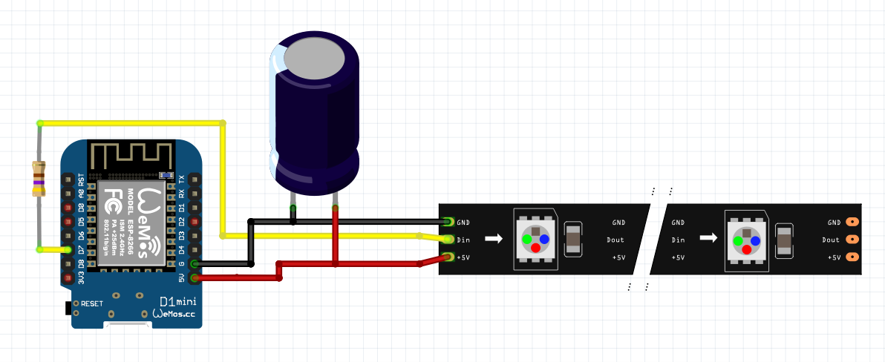

# Moon Lamp LED Controller

Smart illumination for a 3D-printed moon lamp, based on an ESP microcontroller and a WS2812B LED strip. The lamp can be switched on and off and its colour and brightness can be set – via a simple HTTP interface or, with the modern setup, directly from **Home Assistant**.

The housing is a reprint of this design: [thingiverse.com/thing:3531429](https://www.thingiverse.com/thing:3531429)

## Two ways to build it

| | **Classic** | **Modern (recommended)** |
|---|---|---|
| Board | Wemos D1 mini (ESP8266) | ESP32-C3 Super Mini |
| Connector | Micro-USB | **USB-C** |
| Firmware | Arduino sketch in [`MondLED-Server-NeoPixel-OTA_GitHub`](./MondLED-Server-NeoPixel-OTA_GitHub) | ESPHome configuration in [`esphome`](./esphome) |
| Control | HTTP commands | Home Assistant (native API), also usable from the ESPHome web server |
| State after power loss | Stored in EEPROM | Restored by ESPHome (`restore_mode`) |
| Updates | OTA via Arduino IDE | OTA via ESPHome |

Both variants use the same LED strip and the same wiring principle.

## Hardware

### Components
- Microcontroller: **ESP32-C3 Super Mini** (modern, USB-C) *or* Wemos D1 mini / NodeMCU with ESP8266 (classic)
- WS2812B LED strip (5 V)
- 1000 µF electrolytic capacitor (between 5 V and GND of the strip, observe polarity)
- 470 Ω resistor in the data line
- 5 V power supply, dimensioned for the strip (roughly 60 mA per LED at full white)

### Wiring

Connect the strip as follows:

| Strip | Microcontroller |
|---|---|
| +5 V | 5 V |
| GND | GND |
| DIN | data pin via the 470 Ω resistor |

Place the capacitor directly across +5 V and GND at the strip's input.

| Board | Data pin |
|---|---|
| ESP8266 (Wemos D1 mini) | D7 (GPIO13) |
| ESP32-C3 Super Mini | GPIO3 (configurable via `led_pin` in the YAML) |



*The sketch shows the classic setup with the Wemos D1 mini. For the ESP32-C3 Super Mini, only the data pin changes.*

### Notes for the ESP32-C3 Super Mini
- The board is powered and flashed via **USB-C**.
- The red LED is the power indicator, wired directly to the supply. It cannot be switched off in software; cover it or remove it if it disturbs inside the lamp.
- The blue LED on GPIO8 is user-controllable and stays unused in this project.
- Avoid GPIO8 and GPIO9 for the LED strip (strapping pins).
- Some Super Mini boards have a weak antenna and fail to connect to WiFi ("Auth Expired" in the log). The provided configuration therefore sets `output_power: 8.5dB`, which fixes this in most cases.
- The data signal is 3.3 V. For short cables and a small strip this works with WS2812B; with long cables or problems, add a level shifter (e.g. 74AHCT125).

## Modern setup: ESP32-C3 + ESPHome + Home Assistant

1. Install [ESPHome](https://esphome.io) (command line or the Home Assistant add-on).
2. Copy [`esphome/secrets.yaml.example`](./esphome/secrets.yaml.example) to `esphome/secrets.yaml` and fill in your WiFi data and passwords. This file is excluded from git.
3. Adjust `num_leds` (and `led_pin` if needed) in [`esphome/mondled.yaml`](./esphome/mondled.yaml).
4. Flash the first time via USB-C:
   ```bash
   esphome run esphome/mondled.yaml
   ```
   Later updates run over the air.
5. In Home Assistant, open **Settings → Devices & Services**. The device is discovered automatically as **MondLED**. Confirm it and enter the API encryption key from your `secrets.yaml`.

The lamp then appears as a light entity (`light.mondled_mond_led`) with on/off, colour and brightness. It can be used in dashboards, scenes, automations (e.g. sunset, bedtime) and voice assistants.

## Classic setup: ESP8266 + Arduino + HTTP

An HTTP server on the ESP8266 switches the light and sets the colour. The last state (on/off, colour, brightness) is stored in the EEPROM and restored after a power loss.

### Compiling
1. Install the ESP8266 board package and the *Adafruit NeoPixel* library in the Arduino IDE.
2. Copy `MondLED-Server-NeoPixel-OTA_GitHub/secrets.h.example` to `secrets.h` and enter your WiFi name, WiFi password and an OTA password. This file is excluded from git.
3. Select your board (e.g. NodeMCU / Wemos D1 mini) and upload.

### HTTP commands
- `http://IP-ADDRESS/on` – switch the light on
- `http://IP-ADDRESS/off` – switch the light off
- `http://IP-ADDRESS/command.html?param=setColor&value=red,green,blue` – switch on and set the colour; each value is 0…255 (e.g. `255,0,0` = pure red)
- `http://IP-ADDRESS/command.html?param=getColor` – returns the current colour and state as `red,green,blue,on` (`true`/`false`)
- `http://IP-ADDRESS/reset` – restarts the controller after 10 seconds

### Code structure
- `JomjolGitServerClass` – basic HTTP server
- `JomjolGitLEDBandComm` – communication with the LEDs and EEPROM handling
- `LED-Server-Class` – combines HTTP server and LED control
- `MondLED-Server-NeoPixel-OTA_GitHub.ino` – setup and main loop, WiFi connection and OTA interface

## Security note

Never commit WiFi names, passwords or API keys. Both firmware variants therefore read their credentials from local files (`secrets.h` / `secrets.yaml`) that are listed in `.gitignore`. Only the `*.example` templates are part of the repository.

## License

See [LICENSE.md](./LICENSE.md).
